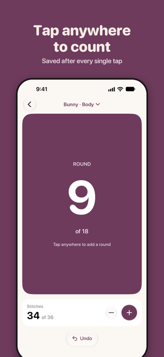
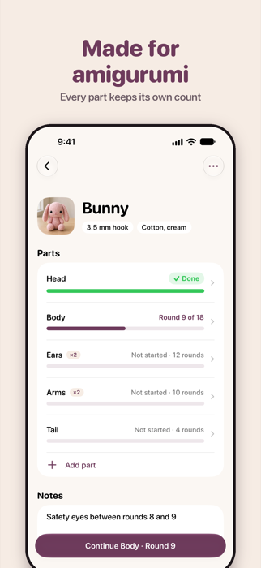
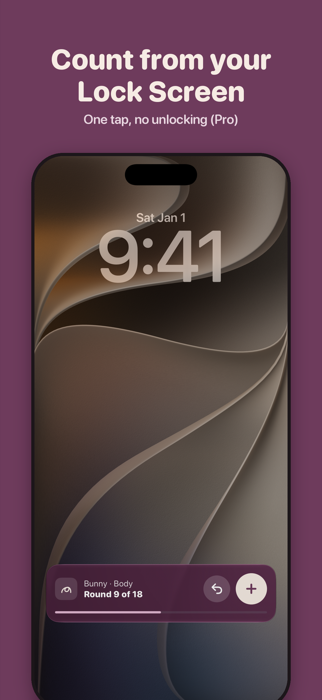
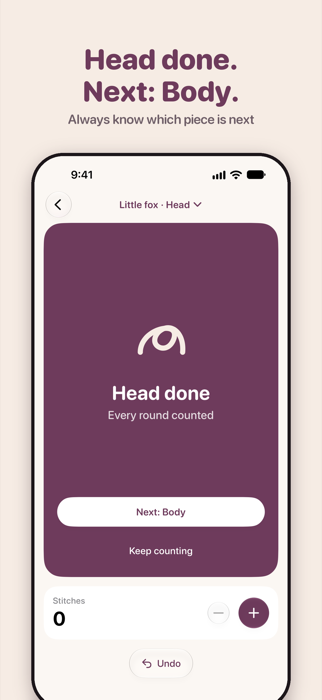
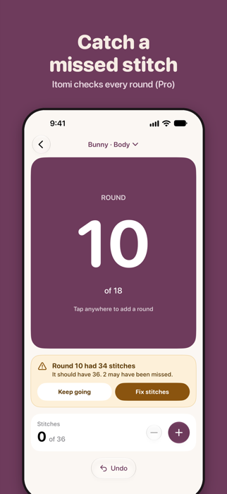
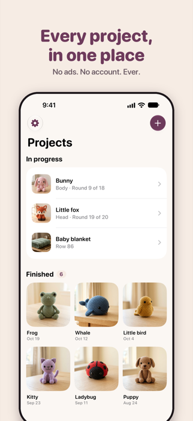
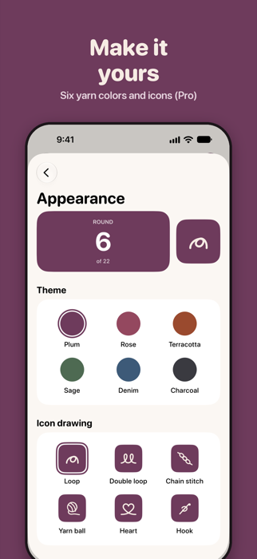

  

<h1 align="center">Itomi</h1>

<em>A calm row and stitch counter for crochet, made for amigurumi.</em>

  
  
  
  
  

Itomi (ee-TOH-mee, "beautiful thread") is a row and stitch counter for crocheters and knitters. Split an amigurumi into parts like Head, Body and Ears ×2, count each one with a single tap, and always see which pieces are left. Every tap is saved right away, so you never lose your place, even after days away.

## Screenshots

  
  
  
  

  
  
  

## Features

- [x] Projects with photo, hook or needle size, yarn and notes
- [x] Big tap-anywhere row/round counter, stitch counter and undo, saved after every tap
- [x] Parts (Head, Body, Ears ×2), each with its own counter
- [x] "Head done, next: Body" moment and a "Welcome back" note after time away
- [x] Assembly checklist (stuff, sew on, embroider the face), then a Finished shelf
- [x] Backup and restore, always free
- [x] Pro (yearly or lifetime): Lock Screen and Dynamic Island counter, Siri, Action Button and Control Center counting, stitch-count warnings, unlimited projects, themes and app icons, and "Make another"
- [x] No ads, no account

## Why I Built It

Most counter apps treat a project as one long list of rows. Amigurumi doesn't work that way: a bunny is a head, a body and two ears, each with its own rounds. I wanted a counter built around those parts, fully native in SwiftUI, and calm to use, with no ads and nothing in the way while you're counting.

## Tech Stack

| Layer | Technology |
|-------|------------|
| App | Swift, SwiftUI, iOS 26 |
| Local data | SwiftData |
| Lock Screen and Dynamic Island | ActivityKit (Live Activity) |
| Siri, Action Button, Control Center | App Intents, WidgetKit |
| Purchases | RevenueCat |
| Analytics | TelemetryDeck (anonymous) |

## Privacy Policy

[Privacy Policy](https://imaryanl.github.io/itomi-privacy)

## Contact

Built by **Aryan Lakhani**

